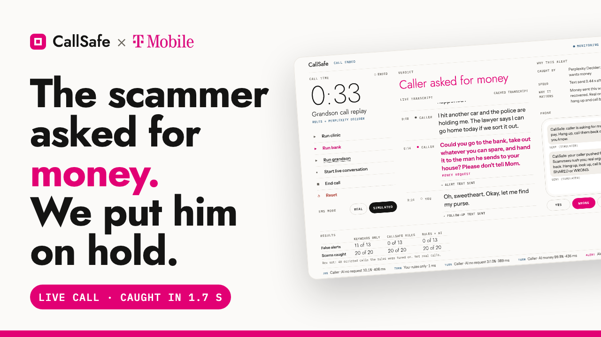
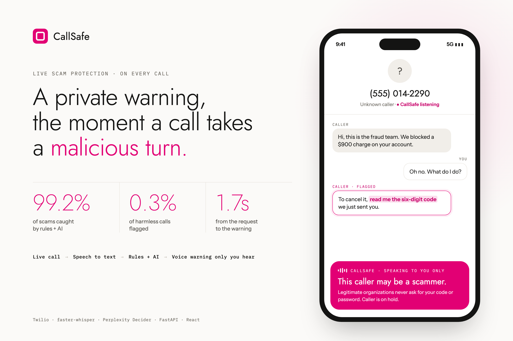

# CallSafe

**A private warning the moment a phone call takes a malicious turn.** Built at HackUTD 2026.



Spam filters judge a call before you answer. After you pick up, a good scammer is in control. CallSafe protects you **during** the call. When the caller asks for a one-time code, money or access to your device, CallSafe puts them on hold, plays a short warning that only you hear, and then reconnects you.

## How it works



1. **Live call.** Twilio carries the call and streams both sides of the audio to CallSafe.
2. **Speech to text.** Whisper transcribes each turn on our own machine. Nothing is recorded.
3. **Rules + AI.** Scam rules check every caller turn. When `INTENT_MODEL=on`, an AI model (Perplexity Decider) also catches requests the rules miss, like *"take out whatever you can spare and hand it to the man he sends."*
4. **Private warning.** The caller goes on hold and you hear something like *"CallSafe alert. This caller may be a scammer. They asked you for a code… Hang up, and call them back on a number you trust."* Then the call reconnects.

An operator console shows the whole thing as it happens: the live transcript, the flagged line, the reason for the alert and how fast it fired.

## Results

| | Keywords only | Rules + AI |
|---|---|---|
| Scams caught | 84.3% | **99.2%** |
| Harmless calls flagged | 64.4% | **0.3%** |

On a live call, the warning arrives about **1.7 seconds** after the caller makes the request.

<sub>Blind test of 6,228 scripted calls, not real customer calls. The rules + AI numbers were measured with our previous AI model, not yet with Perplexity Decider.</sub>

## Privacy

- Audio is transcribed in memory and thrown away. Transcripts are dropped when the call ends.
- Phone numbers are stored only as salted hashes.
- The AI step sends caller text to an outside service, so it's off unless you turn it on. Details are in [docs/twilio-live.md](docs/twilio-live.md#7-data-that-leaves-the-laptop).

## Try it

You need Python 3.11, [uv](https://docs.astral.sh/uv/) and Node 20+.

```bash
cp .env.example .env     # set OPERATOR_PASSWORD, SESSION_SECRET and CONSENT_SALT
make install
make demo ARGS="--no-twilio"
```

Open the console URL it prints and log in with your `OPERATOR_PASSWORD`. Then try:

- **Replays.** `Run clinic` (a harmless call that should stay silent), `Run bank` (the caller asks for a one-time code) and `Run grandson` (the caller asks for cash in words the rules don't catch).
- **Live mic.** Click `Start live conversation`, then take turns with the `Caller` and `You` buttons. Open the console on `localhost`, because browsers only allow the mic there or over HTTPS.
- **Real phone call.** Run `make demo` with Twilio credentials in `.env`. See [docs/twilio-live.md](docs/twilio-live.md).

Without Twilio, alerts show up as texts on a simulated phone in the console.

## Built with

Python 3.11 · FastAPI · faster-whisper · Twilio Voice + Media Streams · Perplexity Decider (through OpenRouter) · React + Vite · SQLite

| Folder | What's in it |
|---|---|
| `backend/app` | API, call pipeline, Twilio voice and SMS |
| `policy/v1.0` | Scam rules and alert wording (YAML) |
| `console/` | Operator console (React) |
| `eval/` | Accuracy evaluation scripts |
| `scenarios/demo` | The demo calls |

## Docs

- [Live Twilio setup](docs/twilio-live.md): real phone calls, the tunnel and what leaves the laptop.
- [Verification](docs/verification.md): how we test the real app end to end.
- [PRD.md](PRD.md): the full product spec.
- [AGENTS.md](AGENTS.md): how humans and agents work in this repo.

## For contributors

```bash
make test            # pytest
make smoke           # ruff + pytest + OTP fixture replay (required before merging)
make verify-changed  # drives the real app for the features you touched
make verify          # all features, about 4 minutes
```

Never commit `.env`.
